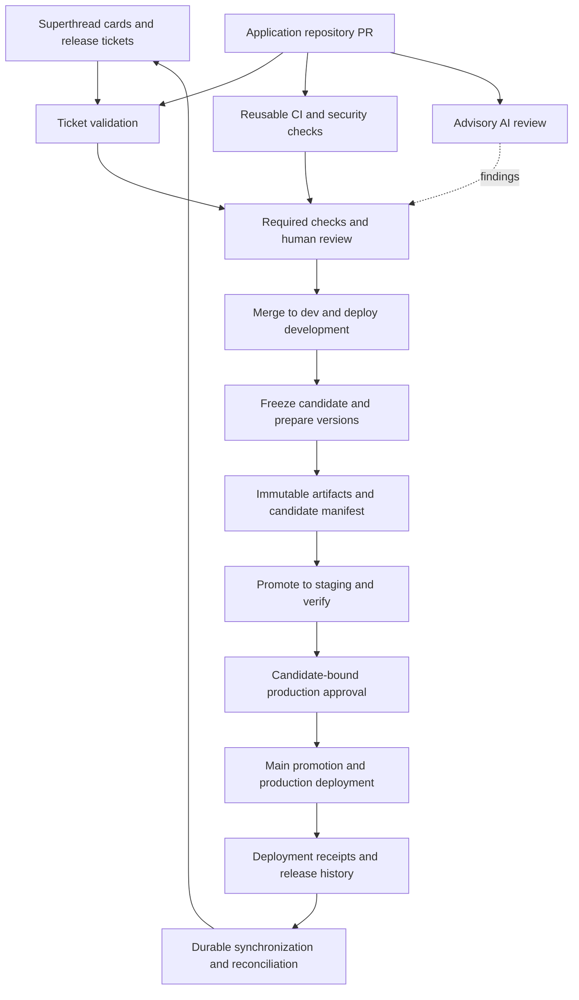

# Implementation Plan: Engineering Automation Platform

Status: Pilot in progress. Shared Node CI/security, branch merge gates, native Superthread PR linking, and basic authenticated ticket scope validation are implemented. Advisory PR-Agent review with Gemini 3.1 Flash-Lite has passed live inference and comment publishing; degraded feedback is also verified. Finding quality evaluation, releases, deployments, and durable synchronization remain pending. See docs/advisory-ai-review.md for evidence.

Source: `Raw Complete plan - Automated PR review, Superthread integration, multi-repo releases, and deployment.md`, read in full, including its failure cases and final checklist.

## 1. Outcome and scope

Build a shared engineering automation platform connecting Superthread cards, GitHub PRs, deterministic checks, AI review, environment deployments, component releases, and coordinated product releases.

The platform must support different repository languages and hosting targets. Preserve the agreed development flow: feature/fix branches into `dev`, release promotion through `staging`, and approved production releases through `main`. Staging verification and release-owner approval replace a separate QA stage.

Success means:

- Invalid changes cannot bypass required checks and human review.
- Each meaningful change is traceable to its card, PRs, commits, artifacts, and deployment results.
- Production receives the approved staging artifact, identified by immutable digest.
- A product release tracks every required component and reports partial failure accurately.
- Automation retries safely, recovers from outages, and never equates a merge with a successful deployment.

Initial scope includes reusable CI/security workflows, advisory PR-Agent review, ticket validation, native Superthread integration, release candidates, controlled deployments, component versioning, product manifests, reconciliation, and recovery runbooks.

Defer SonarQube, a custom webhook service, advanced AI blocking, additional language workflows, and a platform dashboard until a measured need exists. Reuse existing hosting. Custom implementation should concentrate on policy validation, synchronization gaps, and product release orchestration.

### 1.1 Personal-account pilot and later organization adoption

Build and validate the first installation under the user's personal GitHub account. An organization is not a prerequisite for the pilot. Use one representative application repository first, then a second repository to demonstrate a coordinated product release. Java workflows are outside the current scope.

Confirmed pilot settings: GitHub owner `ShubhamSPawade`, owner type `User`, subscription GitHub Free, public repositories `engineering-platform` and `engineering-demo-api`. GitHub publication and actual workflow execution have been verified through the authenticated CLI. The demo default branch is dev, with dev/staging/main protected by active ruleset `24841800`.

Pilot application: the dependency-free Node.js 24 API in `demo-api/` is published separately as `ShubhamSPawade/engineering-demo-api`. It includes health/version/greeting endpoints, 24 API/configuration tests, packaging and smoke scripts, a Dockerfile, and pinned callers for shared CI/security. The demo folder is ignored by the platform repository.

Verified progress: the ruleset requires PRs, resolved review threads, current demo-verify and superthread-ticket statuses on dev/staging/main, blocks deletion and force pushes, and requires zero approving reviews for the solo pilot. PRs #1 and #2 adopted shared Node CI and security; actual GitHub runs passed. Semgrep's initial fixture-layout failure was fixed before merging. Gitleaks and Semgrep run; OSV validates the dependency-free inventory and skips vulnerability scanning when empty.

Superthread pilot: the only registered space/board is test-demo / Engineering Demo. The user confirmed PR #3 linking and merged-status display on card ST-1754. Workflow run `38061705298` verified workspace tg14m1lv, space 9, board 17 and card 1754 through GET requests only. PR #4 installed a trusted, pinned platform ticket check. On PR #5, live missing-title and wrong-workspace cases failed and GitHub reported BLOCKED; local tests also cover wrong-board, archive and API-error rejection. Basic identity/membership enforcement is implemented; mandatory card content, dependency/cancellation rules, multiple-card support, approved exceptions and durable synchronization remain pending. This is partial P2 delivery, not completion of the full ticket-policy design.

Keep reusable automation independent of the installation. Parameterize GitHub owner and owner type (`User` or `Organization`), platform repository, registered application repositories, GitHub App installation identity, Superthread workspace/board/status mapping, artifact locations, deployment adapters, and approval policy. Store credential values in the installation's secret stores, never in shared configuration. Do not hard-code the personal username into scripts, cloud trust policies, registry paths, or generated manifests.

Private reusable workflows can be shared with other private repositories owned by the same personal account when access settings allow it. Verify the pilot's subscription, visibility, and supported protections before enabling gates. [GitHub Actions repository settings](https://docs.github.com/en/repositories/managing-your-repositorys-settings-and-features/enabling-features-for-your-repository/managing-github-actions-settings-for-a-repository)

If the user is the only contributor, exercise automated checks and release authorization in sandbox environments, but mark independent human-review validation as pending until a separate collaborator participates. An author cannot provide independent approval for their own PR. Record unsupported personal-account controls as capability gaps; a manual trigger alone does not prove protected production authorization.

For later adoption, provide an onboarding package that installs the versioned platform repository/configuration under each target organization, installs or authorizes the GitHub App for its selected repositories, configures its secrets/OIDC identities and environments, maps its Superthread workspace, and applies supported organization policies. Reusable workflow caller references must point to a location the target repositories are permitted to access; do not assume a private personal repository can serve unrelated organizations.

Default to a separate installation per organization, with isolated secrets, state, storage access, and product locks. This is portable automation, not a requirement to build a multi-tenant hosted service. Transfer the pilot repository only if moving that particular installation is desired; distributing the project to multiple organizations uses separate installations instead.

Add a portability acceptance test in P6: onboard a fresh owner/organization configuration with new installation credentials, run a representative PR and sandbox release, and verify no dependency on the personal installation's username, secrets, Superthread workspace, or stored state.

## 2. Decisions to establish before implementation

The workspace currently contains the source plan, with no application code or repository configuration to assess. The following are implementation discovery tasks, not assumptions about an existing organization.

| ID | Decision/input | Proposed default | Owner | Required before |
| --- | --- | --- | --- | --- |
| D01 | Personal account first; later target organizations, repositories, products, owners, dependencies | Inventory each repository and map it to a product/component; configure owner type explicitly | Platform lead + repository owners | Foundation |
| D02 | GitHub subscription and available controls | Verify private workflow sharing, rulesets, environment protection, and reviewer availability for each installation | Account owner / organization administrator | Enforcing gates |
| D03 | Superthread team/board IDs, card identifiers, statuses, permissions | Use actual card URLs/IDs; `ST-142` remains an illustration | Work-management owner | Ticket validation |
| D04 | Build tools, test commands, deployments, network access | Preserve current commands and hosting; add an adapter contract | Repository owners | CI and deployment |
| D05 | Required reviews, risk classification, security thresholds | One non-author approval plus applicable CODEOWNER approval; additional approval for high-risk changes | Engineering + security leads | Required checks |
| D06 | AI provider, model, retention, allowed source sharing, budget | Approved provider; advisory findings; bounded cost and retries | Security + platform leads | AI pilot |
| D07 | Artifact registry and durable metadata store | Existing registry plus durable object storage for immutable records and synchronization outbox | Platform lead | Release pilot |
| D08 | Product compatibility and rollout order | Explicit dependency graph; backward-compatible rolling deployment | Release owner + component owners | Multi-repo release |
| D09 | Product version policy | Explicitly declare patch/minor/major impact in release intent; validate rationale rather than infer from largest component version | Product + release owners | Product versioning |
| D10 | Recovery targets, backup readiness, alert destination | Document per service; identify an authorized recovery owner | Service owners | Production |
| D11 | Completion rules and exceptions | Deployment-dependent cards require verified target environment; docs/libraries have explicit alternative rules | Engineering + work-management owners | Status automation |

Native Superthread documentation describes multiple PR links, branch-specific PR status automation, and a public API. Deployment completion semantics, API fields/permissions, rate limits, and webhook capabilities still require workspace verification. Do not design around unverified inbound events. [Superthread integration documentation](https://superthread.com/features/integrations/)

Private reusable workflow access and environment protection must be checked against each account's settings and subscription before committing to enforcement. Organization adoption also requires checking organization-level policies. [Workflow sharing](https://docs.github.com/en/actions/how-tos/reuse-automations/share-with-your-organization), [deployment environments](https://docs.github.com/en/actions/reference/workflows-and-actions/deployments-and-environments)

## 3. Architecture and responsibility boundaries



| Layer | Responsibility | Location |
| --- | --- | --- |
| Shared automation | Reusable workflows, schemas, policies, synchronization/release scripts | `engineering-platform` repository |
| Application adapter | Build/test commands, runtime versions, artifact packaging, deployment/health/recovery commands | Each application repository |
| Work management | Acceptance criteria, scope, dependencies, card ownership, release intent | Superthread |
| Orchestration | PR checks, explicit dispatch, candidate validation, fan-out/fan-in, scheduled reconciliation | GitHub Actions |
| Release evidence | Immutable candidate manifests, append-only deployment receipts, event/outbox records | Durable metadata storage |
| Deployment | Environment-specific runtime and credentials | Existing hosting + GitHub Environments |

Use a narrowly scoped GitHub App installation token for authorized cross-repository operations. Each repository's ordinary jobs use its own least-privilege `GITHUB_TOKEN`. Separate review/comment permissions from release/dispatch permissions.

A dispatched payload expresses a request, not proof of authorization or success. Validate sender/installation, registered repository, workflow version, release identity, candidate SHA, and artifact digest. The orchestrator must confirm actual workflow/deployment results before moving forward.

## 4. Repository and configuration deliverables

```text
engineering-platform/
  .github/workflows/
    reusable-node-ci.yml
    reusable-python-ci.yml
    reusable-security.yml
    reusable-ai-review.yml
    reusable-ticket-validation.yml
    create-release-candidate.yml
    promote-staging.yml
    production-release.yml
    reconcile.yml
    audit-repository-policy.yml
  configs/
    repositories.yml
    products.yml
    superthread-status-map.yml
    labels.yml
    pr-agent/
  policies/
    branching.yml
    pull-request.yml
    security.yml
    ticket.yml
    release.yml
    exceptions.yml
  schemas/
    repository-config.schema.json
    candidate-manifest.schema.json
    deployment-receipt.schema.json
    sync-event.schema.json
  scripts/
    validate-ticket/
    validate-candidate/
    orchestrate-release/
    synchronize-ticket/
    reconcile/
  docs/
    onboarding.md
    branching-strategy.md
    definition-of-done.md
    hotfix-process.md
    release-runbook.md
    incident-recovery.md
```

Each application receives thin CI/security/review caller workflows, repository-specific deployment workflows, `CODEOWNERS`, a PR template, release configuration, and a platform configuration declaring commands, dependencies, completion rules, and deployment adapter behavior.

Pin reusable workflows and third-party actions to reviewed commit SHAs. Publish platform versions with migration notes; upgrade callers through reviewed PRs. Protect workflow, deployment, policy, release-config, and ownership files. A drift audit detects repositories missing controls; templates alone do not enforce policy.

Reusable workflows must declare inputs, secrets, outputs, required permissions, and failure behavior. Keep deployment credentials attached to jobs in the appropriate environment. Test secret handling explicitly because environment secrets in a called workflow can override passed secrets. [Reusable workflow documentation](https://docs.github.com/en/actions/how-tos/reuse-automations/reuse-workflows)

## 5. PR checks and merge policy

### 5.1 Required deterministic checks

Run appropriate jobs concurrently and publish stable check names:

| Check | Behavior |
| --- | --- |
| `ticket-policy` | Validate linked card(s), acceptance criteria, dependencies, cancellation, and approved exceptions |
| `ci-quality` | Formatting/lint/types applicable to the stack |
| `ci-tests` | Unit tests and required integration/contract tests |
| `ci-build` | Build/package successfully; validate relevant migration/configuration changes |
| `security-policy` | Aggregate secrets, dependencies, static analysis, and applicable image/IaC scans |
| `promotion-policy` | On release PRs, verify candidate identity, branch eligibility, compatibility, and promotion evidence |

Run ESLint/Prettier/TypeScript/Jest or Vitest for relevant JS/TS repositories; Ruff/pytest and applicable mypy checks for Python. Add Gitleaks, OSV-Scanner, scoped Semgrep rules, Trivy for container images, and applicable IaC checks.

The required aggregate security check must always produce a result. An irrelevant scanner may be recorded as not applicable; an unavailable required scan is incomplete. Do not use path filtering that leaves a required check permanently absent. Establish baseline findings and tracked remediation deadlines rather than silently excluding legacy vulnerabilities.

Require review approval, resolved blocking review conversations, fresh checks on the current PR revision, and stale-approval dismissal after relevant changes. Disallow ordinary direct pushes to protected branches. Record tightly scoped emergency bypasses with owner, reason, expiry, and follow-up.

Use a merge queue where supported and needed; support its `merge_group` event in required checks. Without a queue, require current-base validation through the repository's supported branch controls.

### 5.2 AI review

Run PR-Agent against the diff and limited approved ticket context. Focus on correctness, authorization/isolation, concurrency, data integrity, API compatibility, performance, secrets/logging, test gaps, and acceptance criteria.

The reviewer may read source and write PR comments/reviews; it receives no deployment or repository-content write access. Use trusted review configuration. Treat PR text, code, and ticket content as untrusted input; never let model output execute commands or change release policy.

For forks, use a trusted API-only review path that does not execute PR code with provider credentials. PR-Agent documents fetching PR data without a checkout; review the pinned implementation and disable unwanted write features. Restrict comment-triggered commands to authorized users. [PR-Agent GitHub integration](https://docs.pr-agent.ai/installation/github/)

Initially AI is advisory and absent from the required merge gate. Publish review success/failure visibly. Retry bounded transient failures; label an outage as unavailable and preserve human review. If enforcement is later introduced, define validated finding categories and an auditable, authorized degraded mode first.

Evaluate on historical PRs and known defects, recording reviewer-confirmed usefulness, false positives, latency, and cost. Suggested pilot: at least 20 representative PRs, expanded when stack/risk coverage is insufficient. Human evaluation, not raw comment count, determines readiness.

## 6. Superthread synchronization and durable state

### 6.1 Event ownership

Use native integration for verified PR linking/status features. Add GitHub Actions/API updates for missing deployment/release behavior. Give each transition one owner; disable overlapping native rules, particularly merge-to-Done behavior for deployment-dependent cards.

| Event or condition | Desired card/release behavior |
| --- | --- |
| Draft PR | In Progress/Draft; retain PR link |
| PR ready for review | In Review unless blocked/cancelled |
| Active changes-requested review | Changes Requested; aggregate across required PRs |
| PR merged into dev | Record merge and dev deployment separately |
| Required implementation complete | Ready to Release if deployment is still required |
| Staging verified | Link candidate and staging receipt; remain open if production is required |
| Required production deployment verified | Complete only when all required PRs/components and acceptance criteria are satisfied |
| PR closed without merge | Record closure; never infer completion |
| Deployment fails | Keep release/work incomplete; link recovery/incident evidence |
| Blocked/cancelled card | Preserve human decision; report conflict rather than overwrite |
| Manual Done inconsistent with evidence | Flag for owner resolution and audit; avoid automatic oscillation |

Superthread owns scope, acceptance criteria, and human priority/dependency decisions. GitHub owns code/review/check facts. Deployment receipts own deployment facts. Card status is a derived projection subject to explicit human holds. Acceptance criteria that require human judgment need owner confirmation; passing CI alone does not prove them.

### 6.2 Validation contract

Support a canonical ticket field in the PR body plus verified branch/title forms. Reject conflicting IDs; validate every declared required card. Check card existence/access, cancellation, mandatory content, dependencies, affected repositories, and completion type. Link idempotently.

Missing or invalid tickets fail policy with actionable guidance. API outage is a distinct unavailable result and fails closed for mandatory validation unless an authorized temporary exception is recorded. Never create tickets automatically on retries. Routine dependency or documentation automation may use an explicit exception policy.

### 6.3 Persistence and reconciliation

Store PR-to-card associations, required PR/component sets, event identity, desired updates, retry attempts, last applied state, and audit evidence durably. Registration of the required work set is essential: currently visible PRs are not sufficient to prove no further repository work is required.

Use a transactional durable outbox before external writes. GitHub run logs and expiring artifacts are supporting evidence, not the only pending-event store. The initial implementation can use versioned object storage and conditional writes; select a database if the chosen store cannot support safe concurrent updates.

Deduplicate deliveries by delivery ID and semantic actions by repository/PR/head SHA/event/state or release/component/environment/attempt. Retry with bounded exponential backoff and jitter; honor rate-limit responses. Escalate exhausted retries and retain them for replay.

Serialize updates per card and recompute desired state from current authoritative facts so stale or out-of-order events cannot regress it. A scheduled/manual reconciliation workflow repairs missed updates, compares release receipts to card status, and exposes unresolved conflicts. Start with an hourly schedule, recognizing scheduled Actions are best effort rather than an exact delivery SLA.

Only add a receiver if verified inbound events or latency needs require it. It must verify the provider's supported authentication/signature mechanism, enforce replay limits, persist before acknowledgment, and expose health/error metrics. If Superthread webhooks are unavailable, poll permitted API state instead.

## 7. Release candidate, versioning, and promotion design

### 7.1 Candidate identity

Moving branch names cannot identify an approved release. Every candidate has a stable release ID and immutable manifest containing exact component source commits, versions, build artifacts, dependency constraints, required tickets, and workflow/policy versions.

Proposed implementation adds a short-lived `release/<release-id>` branch per changed component, cut from an explicitly selected `dev` commit. This freezes a candidate while feature work continues on `dev`; it does not add another environment or QA phase. Protect release branches and permit only controlled version preparation before final freeze.

Staging and main promotions may create different merge commit SHAs. Record source and promotion SHAs separately and verify resulting tree equality to the frozen candidate. Preserve promotion history with merge commits; prohibit arbitrary conflict-resolution changes. A conflict, code change, or version-file change requires a new candidate, artifact, verification, and approval.

Start with one active release per product. Acquire a durable conditional lock keyed by product, and retain deployment reservations until recovery/finalization. Actions concurrency controls add protection within a repository but do not replace a cross-repository lock. A candidate whose production baseline changed after a hotfix must be invalidated and regenerated.

### 7.2 Component version preparation

Use Conventional Commit PR titles and squash messages for feature changes. Require explicit breaking-change markers and compatibility notes. Promotion commits must not cause the same change to be counted twice.

Run Release Please against the frozen release branch to prepare a version/changelog PR with release publication disabled. Merge that metadata PR under review, then freeze the final source SHA and build the release artifact. Thus version metadata is included before staging verification.

After production verification, invoke release finalization against that same protected candidate branch, with new release-PR creation disabled. Validate that generated component tags point to the recorded candidate commit; never allow finalization to select a newer moving branch head. Release Please exposes target-branch and separate PR/release controls, but this exact branch/tag lifecycle needs an early proof of concept before adopting it. [Release Please Action documentation](https://github.com/googleapis/release-please-action)

Back-merge release metadata/history into `dev` through a checked PR before preparing the next component version. Do not publish competing version PRs for the same component. A failed deployment retains its proposed version/candidate; recovery may retry it. If any version/tag has been published, preserve it and use a corrective release rather than rewrite history.

For docs or libraries, use their explicit completion/publication workflow; product runtime deployment is not universally required.

### 7.3 Normal release sequence

1. Merge reviewed feature work into `dev`; deploy the resulting commit with development-only credentials and record health/integration results.
2. Release owner selects the product scope and exact component commits. Validate required cards, blockers, migrations, compatibility, baseline, and passing checks.
3. Create frozen release branches; prepare reviewed component versions/changelogs. Reserve a product version with an explicit impact rationale.
4. Build each changed component once from its final candidate SHA. Scan artifacts, record provenance/digests, and publish the immutable candidate manifest.
5. Open controlled staging promotion PRs from the candidate branches. Verify candidate/tree identity and required checks; merge and deploy the recorded artifacts in dependency order.
6. Run startup, health, smoke, integration/contract, and migration verification. Persist per-component staging receipts. Approve the exact candidate manifest digest after successful verification.
7. Open controlled staging-to-main PRs. Recheck candidate identity, production baseline, compatibility, required approvals, and tree equality.
8. After main promotion, require the configured production authorization and deploy the staging-tested digests. Rebuilds are prohibited for normal artifact promotion.
9. Verify production and persist actual component outcomes. Finalize component tags/changelogs and product release history; update cards only from verified evidence.
10. Reconcile ticket/notification/publication failures, synchronize dev metadata, and close the release reservation when finalization or recovery is complete.

Build-time environment differences must be removed through runtime configuration where possible. If a frontend requires environment-specific builds, the staging-tested binary cannot simply be claimed identical to production: redesign configuration or require a documented exception with verification of the actual production artifact before approval.

Cross-repository dispatch is explicit and correlated by release/component/environment/attempt. Use the GitHub App where needed and validate workflow-trigger behavior; do not assume token-generated pushes/tags automatically run another workflow. [GitHub workflow triggering](https://docs.github.com/en/actions/how-tos/write-workflows/choose-when-workflows-run/trigger-a-workflow)

### 7.4 Manifest and receipt contracts

| Record | Required fields |
| --- | --- |
| Candidate manifest | Schema version, product, release ID, product version, previous production release, component repository/version/source SHA/tree hash/artifact URI/digest, changed flag, dependency constraints, tickets/PRs, migration plan, rollout order, creator/time, workflow/policy SHAs |
| Approval evidence | Candidate manifest digest, approver, authorization context, approval time, verified staging receipt references; superseded/invalidation events |
| Deployment receipt | Release/component/environment, attempt ID, candidate digest, source/promotion SHAs, requested and observed artifact digests, provider/run IDs, health/migration outcomes, start/end times, failure/recovery details |
| Final product record | Candidate reference, component deployment receipts, aggregate outcome, publication outcome, previous/actual component state, reconciliation status |

Carry forward unchanged components from the previous verified production manifest so the record describes the whole product. Deploy only changed components unless compatibility requires otherwise.

Candidate manifests are immutable. Append deployment/approval/recovery receipts instead of modifying an approved candidate. Schema validation plus digest verification binds approval and deployment to the same content.

Track deployment outcome separately from publication/synchronization outcome. All components healthy with a failed tag publication means deployment succeeded and finalization remains pending; reruns repair metadata without blindly redeploying.

Use deployment states `pending`, `running`, `succeeded`, `failed`, `partially_failed`, `rolled_back`, and `cancelled`. Product success requires all required component receipts and product smoke tests. A rollback records restored observed state; it does not erase the failed attempt.

## 8. Deployment, credentials, and recovery

Each deployment adapter accepts release identity and immutable artifact reference, applies only environment-specific configuration, and returns deployment identity, observed artifact, health result, and migration result. Each recovery adapter identifies its supported safe recovery operation and post-recovery verification.

Separate dev, staging, and production credentials. Use OIDC where supported, with trust conditions restricted to the intended organization, repository, environment, and workflow context. Production credentials become available only after the production gate. Secure network-restricted deployment paths or isolated runners must be established before onboarding.

Cancel superseded PR checks safely. Serialize state-changing environment deployments and do not automatically cancel an in-progress production migration or rollout. Prevent an older dev deployment from replacing a newer one after jobs finish out of order. Release cancellations record the actual deployed state.

Define rollout order, timeouts, health thresholds, rollback criteria, alert routing, and recovery authorization per product. Cross-repository rollout is not an atomic transaction. Prefer compatible intermediate states and use feature flags where applicable.

Before production, rehearse recovery to the last known-good digest. For migrations use expand/migrate/contract where feasible, ensure backups and restore procedures exist, and specify forward-fix/manual recovery when rollback is unsafe. Code rollback must not pretend to undo destructive database changes.

Hotfixes start from current verified production/main, use expedited required checks and authorized approval, and produce a new candidate/receipt/version. Apply urgent changes to `dev` and `staging` through checked back-merge PRs. Resolve branch drift before resuming ordinary releases.

## 9. Implementation work breakdown and gates

Phases are ordered by operational dependencies. Ticket traceability and deterministic checks precede reliance on AI; the first representative repository is onboarded during development, not left until the final phase.

| Phase | Work packages | Dependencies | Deliverables | Exit gate |
| --- | --- | --- | --- | --- |
| P0: Discovery and design | Inventory; D01-D11; capability checks; release-branch/versioning spike; storage/identity design; select pilot | None | Repository/product inventory, capability matrix, decision log, demonstrated candidate/tag lifecycle | Owners named; critical capabilities and adapter feasibility verified |
| P1: Foundation | Central repo; schemas/configs; policies; templates/CODEOWNERS; GitHub App; dev/staging/prod protections; exception model | P0 | Versioned platform skeleton and pilot registration | Unauthorized direct promotion/credential access denied; controls supported by subscription |
| P2: Deterministic CI and ticket baseline | Pilot-stack reusable CI; security aggregation; required checks; native Superthread setup; card validation; durable links/outbox | P1 | Pilot PR pipeline and ticket policy | Valid PR passes; missing ticket, failing tests/security, and stale checks cannot merge |
| P3: AI and synchronization reliability | PR-Agent sandbox/provider setup; evaluation; status aggregation; retries/dedupe; reconciliation; metrics | P2 | Advisory AI review, reliable ticket projection, pilot evidence | Unsafe fork execution prevented; outages visible; duplicate/out-of-order replay converges |
| P4: Single-repo releases | Dev deploy; release version preparation; immutable packaging; staging promotion; candidate-bound approval; prod adapter; finalization; recovery | P2; P3 synchronization available | One end-to-end controlled release with receipts/runbooks | Same digest verified in staging/prod; failed deploy remains incomplete; safe recovery demonstrated |
| P5: Multi-repo releases | Second repository with different stack/target; dependency/contract checks; orchestrator fan-out/fan-in; product manifests; partial-failure recovery | P4 | Coordinated product release across at least two repositories | All-component success, partial failure, unchanged component carry-forward, and idempotent retry demonstrated |
| P6: Rollout and operations | Fault rehearsals; onboarding automation; drift audit; pinned upgrades; ownership handover; additional repo waves | P5 | Organization rollout, operational dashboards/reports, documented support | Final acceptance checklist evidenced; rollout waves pass before expansion |

Critical path: P0 → P1 → P2 → P4 → P5 → P6. P3 follows P2 and must provide reliable synchronization before release completion automation is accepted. AI enforcement is not on the critical path.

Provisional planning range: 8-12 elapsed weeks for a platform engineer with regular support from repository owners, assuming usable tests and deployment commands already exist. P0 validates the estimate. Missing tests, unsupported controls, restricted deployment networks, or complex migrations require separate estimates; organization-wide rollout scales with repository count.

| Role | Accountability |
| --- | --- |
| Platform lead | Shared automation, identity, state persistence, schemas, orchestration, monitoring |
| Repository owner | Stack checks, adapter implementation, contracts, migrations, service recovery |
| Organization administrator | Rulesets, App installation, permissions, environments, access restrictions |
| Security lead | Thresholds, provider/source-sharing policy, third-party pins, exception review |
| Work-management owner | Card conventions, native integration mapping, required-work registration |
| Release owner | Scope, compatibility/rollout decision, candidate approval, incident coordination |

One person may hold multiple roles, but release approval must comply with non-author and separation requirements established in P0.

## 10. Failure and validation matrix

Execute these scenarios in the pilot/test environments and retain evidence. Validate meaningful invariants rather than test every YAML line.

| Area | Scenarios | Required result |
| --- | --- | --- |
| Ticket policy | Missing/unknown/deleted/inaccessible/cancelled card; no criteria; blocked dependency; conflicting IDs | Actionable failure; no duplicate card creation; no unauthorized override |
| PR checks | Test/build/security failure; cancellation/timeout; conflict; new head after approval; merge queue | Invalid/incomplete checks cannot merge; current revision is validated |
| Review | Changes requested; large/risky PR; shared API change; AI false positive/provider outage | Required human decisions preserved; extra policy review/contracts applied; advisory outage visible |
| PR lifecycle | Draft/reopen/close without merge; duplicate PR; multiple PRs/repos on one card | Aggregated status remains correct; completion requires registered work and criteria |
| Synchronization | Duplicate/out-of-order event; rate limit; API outage; crash before/after write; manual Blocked/Done change | No duplicate side effect; pending work durable; replay converges; human holds preserved |
| Staging candidate | Dev advances; candidate changes; approval becomes stale; different production artifact | Frozen candidate unaffected by dev; changed candidate/digest blocked and reverified |
| Deployment | Dev/staging failure; missing credentials; network failure; production smoke failure; overlapping runs | Accurate environment outcome; production stops or recovers under policy; no stale overwrite |
| Database | Partial migration; destructive migration; recovery failure | Documented migration-specific recovery; no blind data rollback; escalation recorded |
| Product release | One component fails; dependency mismatch; unchanged component; orchestrator timeout | Partial outcome and actual component inventory retained; incompatible progression stopped |
| Finalization | Existing tag; repeat workflow; metadata publication or ticket update fails | No tag overwrite/duplicate publication; resume pending step without unsafe redeployment |
| Hotfix/revert | Hotfix during candidate approval; failed back-merge; rollback/corrective release | Baseline conflict invalidates candidate; drift resolved; original history retained |
| Security | Malicious fork/prompt; exposed secret; unauthorized dispatch; action/policy change | No privileged execution/credential leakage; secret rotation tracked; permissions and pins enforced |
| Rollout | New repo; stack change; central workflow upgrade; drift from required controls | Explicit registration/adapter update; tested pin upgrades; drift produces actionable findings |

Verify gates using actual GitHub sandbox/pilot repositories; workflow linting alone cannot prove protection rules, token restrictions, or approval behavior. Use nonproduction artifacts/credentials for failure injection. Production rollout is preceded by a reviewed readiness record and recovery evidence.

## 11. Observability and operational handover

Correlate logs and evidence by product/release/card/repository/PR/component/environment/attempt. Redact secrets, customer data, and unnecessary source content. Configure retention for manifests, receipts, logs, artifacts, and outbox events so historical releases and recovery remain possible.

Measure PR check duration, check flakiness, AI usefulness/cost, synchronization lag, pending-event age, retry exhaustion, release lead time, deployment failure/rollback rate, and repository policy drift. Establish numeric alert thresholds during the pilot using actual baselines.

Page/escalate production deployment or recovery failure to the authorized owner. Route synchronization failures and stale queues to the integration owner. Publish release notifications only to an explicitly configured destination, with version/component/outcome links.

Runbooks cover normal release, replay/reconciliation, provider outage/degraded mode, lost/expired identity, dependency exceptions, deployment failure, migration recovery, hotfix/back-merge, and platform version upgrade. Document primary/backup ownership, budget controls, and credential rotation.

## 12. Final acceptance checklist

All items begin unchecked. Each completed item must link to configuration and observed validation evidence.

- [ ] 01. Central `engineering-platform` repository created and versioned.
- [ ] 02. Repository/product inventory, ownership, dependencies, and targets documented.
- [ ] 03. Branch rules, PR templates, labels, CODEOWNERS, and policy-file protection configured.
- [ ] 04. Reusable CI workflows pass on representative repositories.
- [ ] 05. Secrets, dependency, and applicable static/image/IaC scans enforce policy.
- [ ] 06. AI review runs safely with evaluated findings and visible degraded behavior.
- [ ] 07. Required checks and approvals demonstrably block invalid merges.
- [ ] 08. Cards are validated and linked to all required PRs/repositories.
- [ ] 09. Native/custom status ownership and completion rules are explicit.
- [ ] 10. Durable retries, deduplication, ordering, and reconciliation are tested.
- [ ] 11. Dev-to-staging-to-main promotion uses frozen candidate evidence.
- [ ] 12. Production runs the approved immutable staging artifact.
- [ ] 13. Component versions, tags/changelogs, and full product manifests are recorded.
- [ ] 14. Health checks, migration recovery, and application recovery are rehearsed.
- [ ] 15. Hotfixes receive required checks and are back-merged without unresolved drift.
- [ ] 16. Failed/partial deployments never complete deployment-dependent work.
- [ ] 17. Multi-PR and multi-repository completion/compatibility are verified.
- [ ] 18. Webhook/API outages and repeated workflows produce no duplicate logical actions.

## 13. Coverage of the source document

| Source sections | Implemented in this plan |
| --- | --- |
| 1-3: Architecture, tools, central repository | Sections 1-4 and 5 |
| 4-5: Development flow and automated review | Sections 5 and 7 |
| 6: Superthread synchronization | Section 6 |
| 7: Multi-repo versions/releases | Section 7 and phase P5 |
| 8: Runtime placement and deployment | Sections 3 and 8 |
| 9: Failure cases | Sections 6-8 and 10 |
| 10-11: Recovery and Definition of Done | Sections 1, 5, 6, and 8 |
| 12: Roadmap | Section 9 |
| 13: All 18 readiness items | Section 12 |
| 14: Recommended stack | Sections 1, 3, and 5; optional tooling remains deferred |

The first implementation deliverable is the P0 inventory, capability matrix, and release lifecycle proof of concept. Production automation follows only after the deterministic gates, durable synchronization, artifact identity, and recovery procedures have been demonstrated.
